

  

<h1 align="center">TARBIYAH</h1>

  <strong>Aplikasi sekolah gratis untuk pondok pesantren, madrasah, dan sekolah.</strong> 
  Presensi, PR &amp; nilai, rapor, SPP, dan pengumuman dalam satu aplikasi di HP.

  
  
  
  

  <a href="docs/manual/pdf/Manual-Lengkap-TARBIYAH.pdf"><strong>📘 Unduh Panduan Lengkap (PDF)</strong></a>
  &nbsp;·&nbsp;
  <a href="#-fitur">Fitur</a>
  &nbsp;·&nbsp;
  <a href="#-tampilan-aplikasi">Tampilan</a>
  &nbsp;·&nbsp;
  <a href="#-ingin-memakai-tarbiyah">Cara memakai</a>

  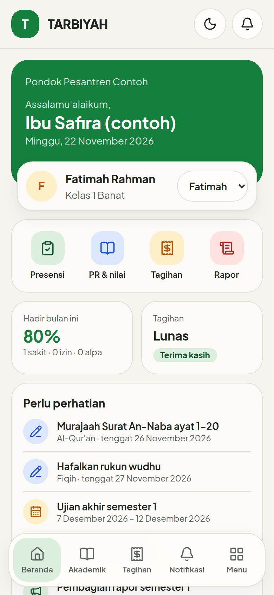
  &nbsp;
  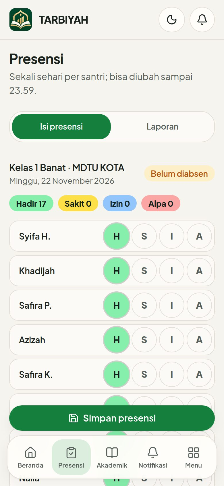
  &nbsp;
  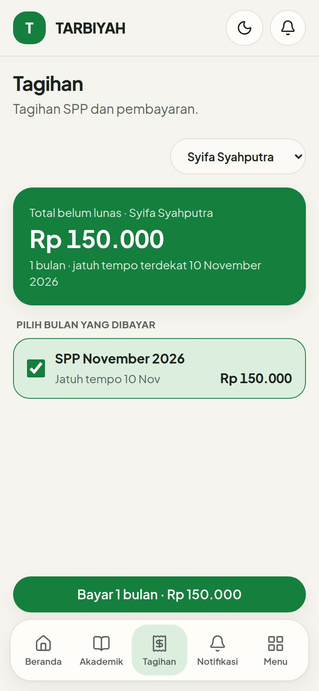
  &nbsp;
  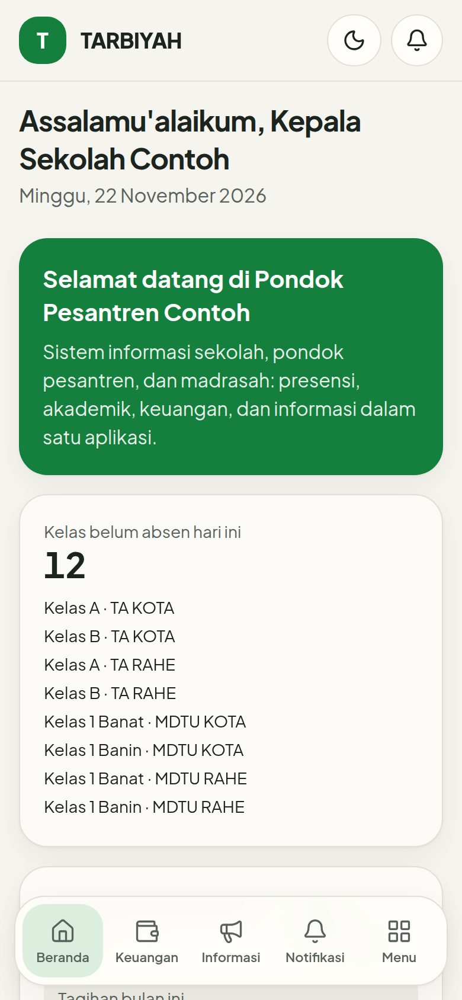

---

## 🌱 Apa itu TARBIYAH?

**TARBIYAH** adalah aplikasi sistem informasi sekolah yang dibuat untuk membantu lembaga pendidikan,
terutama pondok pesantren dan madrasah, mengelola kegiatan harian dengan rapi dan mudah.

Banyak lembaga masih mencatat presensi di buku, mengirim nilai lewat foto, menagih SPP satu per
satu lewat chat, dan menyebar pengumuman di grup WhatsApp yang mudah tenggelam. TARBIYAH
menyatukan semua itu dalam **satu aplikasi** yang bisa dibuka dari HP siapa saja:

- **Wali kelas** mengisi presensi dalam hitungan detik.
- **Guru** memberi PR dan mengisi nilai langsung dari HP.
- **Orang tua** melihat kehadiran, PR, nilai, rapor, dan tagihan anaknya kapan saja.
- **Bendahara** tidak perlu lagi mencatat dan menagih secara manual.
- **Kepala sekolah** memantau seluruh kelas dan keuangan dari satu layar.

## 👥 Untuk siapa?

**Lembaga:** pondok pesantren, madrasah diniyah, TPQ/TPA, madrasah, dan sekolah umum, dari yang
kecil sampai yang punya **beberapa lokasi** (cabang) dan **beberapa unit/jenjang** sekaligus.

| Pengguna | Yang bisa dilakukan |
| --- | --- |
| 👨‍👩‍👧 **Orang tua / wali santri** | Melihat presensi, PR, nilai, rapor, dan tagihan **anaknya sendiri**; membayar SPP lewat QRIS |
| 👨‍🏫 **Guru** | Memberi PR (dengan lampiran), mengisi nilai, dan menyusun nilai rapor mapel |
| 📋 **Wali kelas** | Mengisi presensi harian; mengisi sikap, hafalan, dan catatan rapor |
| 💰 **Bendahara** | Tagihan SPP otomatis, mencatat pembayaran, bukti bayar via WhatsApp, laporan |
| 🏫 **Kepala sekolah** | Memantau semua kelas, mengesahkan rapor, mengirim pengumuman |
| ⚙️ **Admin / TU** | Mengelola data sekolah, santri, guru, pengaturan, dan backup |

Satu orang bisa punya beberapa peran sekaligus, misalnya guru yang juga wali kelas dan orang tua
santri, cukup dengan **satu akun**.

## 💚 Gratis dan open source

TARBIYAH adalah aplikasi **open source** dengan lisensi [MIT](LICENSE):

- **Gratis selamanya.** Tanpa biaya lisensi, tanpa langganan bulanan, tanpa batas jumlah santri.
- **Bebas dipakai siapa saja**: lembaga, yayasan, komunitas, maupun perorangan.
- **Bebas diubah dan dikembangkan** sesuai kebutuhan lembaga Anda, lalu dibagikan kembali.
- **Data milik lembaga sendiri.** Aplikasi dipasang di server milik lembaga, bukan di server pihak
  lain, sehingga data santri dan keuangan tetap di tangan Anda.
- **Kode terbuka**, sehingga bisa diperiksa dan dipercaya.

## ✨ Fitur

### 📋 Presensi
- Presensi harian per kelas dengan satu ketukan: **H**adir, **S**akit, **I**zin, **A**lpa.
- Daftar santri ringkas memakai nama panggilan, nyaman di layar HP.
- Hari libur mingguan dan libur kalender dikenali otomatis.
- Rekap per bulan atau per semester, siap **dicetak atau disimpan sebagai PDF**.

### 📚 Akademik dan rapor
- **PR dan tugas** dengan tenggat dan lampiran foto/PDF; orang tua langsung tahu.
- **Nilai** per penilaian (PR, ulangan harian, UTS, UAS, praktik).
- **Nilai rapor otomatis** dari rata-rata berbobot, lengkap dengan predikat dan deskripsi.
- **Rapor** dengan nilai mapel (plus nama mapel berbahasa Arab), sikap, hafalan, ketidakhadiran,
  dan catatan wali kelas. Orang tua bisa membuka rapor **setelah disahkan**.
- Templat rapor bisa disesuaikan per unit.

### 💰 Keuangan dan SPP
- **Tagihan SPP otomatis** setiap bulan, sesuai tarif per unit dan lokasi.
- **Potongan dan beasiswa** per santri (yatim, anak guru, dan sebagainya).
- **Pembayaran QRIS** dari HP orang tua: lunas otomatis, tanpa perlu konfirmasi manual.
- Pembayaran tunai dan transfer dicatat bendahara.
- **Bukti bayar dikirim lewat WhatsApp** ke orang tua.
- Laporan penerimaan dan tunggakan, siap dicetak.

### 📢 Informasi dan komunikasi
- **Pengumuman** untuk seluruh sekolah, unit, lokasi, atau kelas tertentu.
- **Kalender** agenda dan hari libur.
- **Jadwal pelajaran** semua kelas, bisa dicetak sekaligus.
- **Notifikasi** langsung ke HP (push notification) untuk PR, nilai, dan pengumuman.

### 📱 Nyaman dipakai
- Bisa **dipasang di layar utama HP** seperti aplikasi biasa, tanpa Play Store.
- Tampilan khusus HP dengan menu di bagian bawah, dan tampilan lengkap di komputer.
- **Mode terang dan gelap.**
- Masuk cukup dengan **nomor HP**; lupa password bisa diatur ulang lewat kode WhatsApp.
- Seluruhnya dalam **Bahasa Indonesia**.

### 🔒 Aman dan tertib
- Setiap orang hanya melihat data sesuai perannya; **orang tua hanya melihat data anaknya**.
- **Backup otomatis** terjadwal (bisa setiap hari) dengan salinan ke penyimpanan cloud, dan bisa
  dipulihkan kapan saja.
- **Catatan aktivitas**: siapa mengubah nilai, presensi, tagihan, atau pengaturan.
- Persetujuan pemrosesan data dari orang tua saat pertama masuk.

### 🗂️ Administrasi
- **Impor data santri dan wali dari Excel** sekaligus.
- **Naik kelas massal** di akhir tahun ajaran (naik, tinggal kelas, lulus, pindah).
- Mendukung **banyak lokasi dan unit** dalam satu lembaga.

## 📸 Tampilan aplikasi

<table>
  <tr>
    <td align="center" width="33%"> <b>Beranda orang tua</b> Kehadiran, tagihan, PR, dan pengumuman</td>
    <td align="center" width="33%">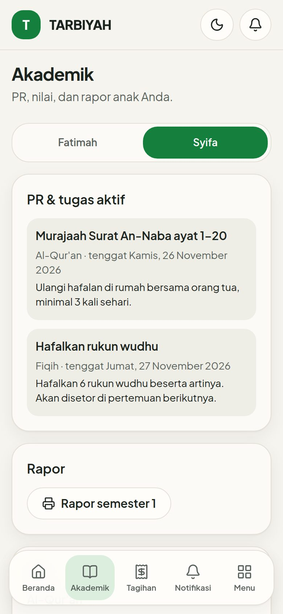 <b>PR, nilai, dan rapor anak</b></td>
    <td align="center" width="33%"> <b>Bayar SPP lewat QRIS</b> Pilih bulan, bayar, lunas otomatis</td>
  </tr>
  <tr>
    <td align="center"> <b>Presensi harian</b> Satu ketukan per santri</td>
    <td align="center">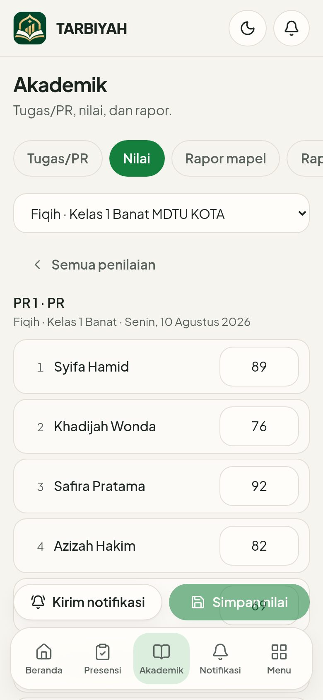 <b>Guru mengisi nilai</b></td>
    <td align="center">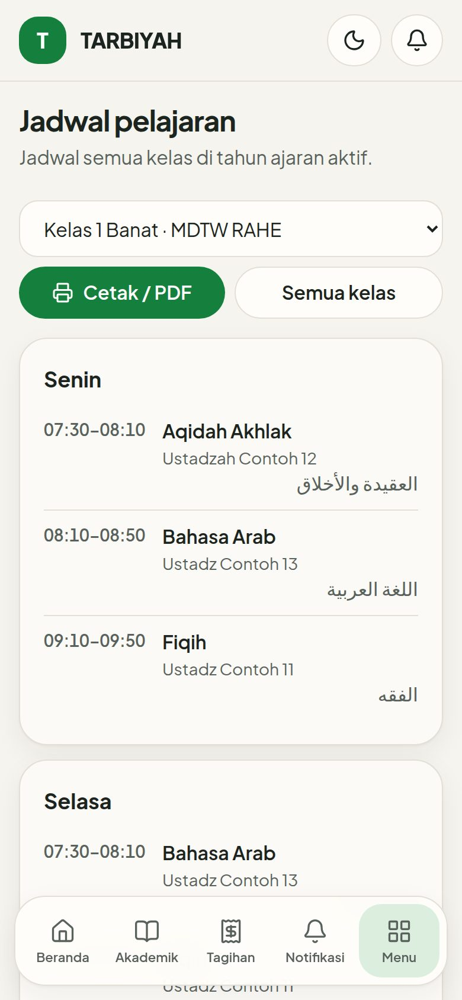 <b>Jadwal pelajaran</b> Bisa dicetak</td>
  </tr>
  <tr>
    <td align="center">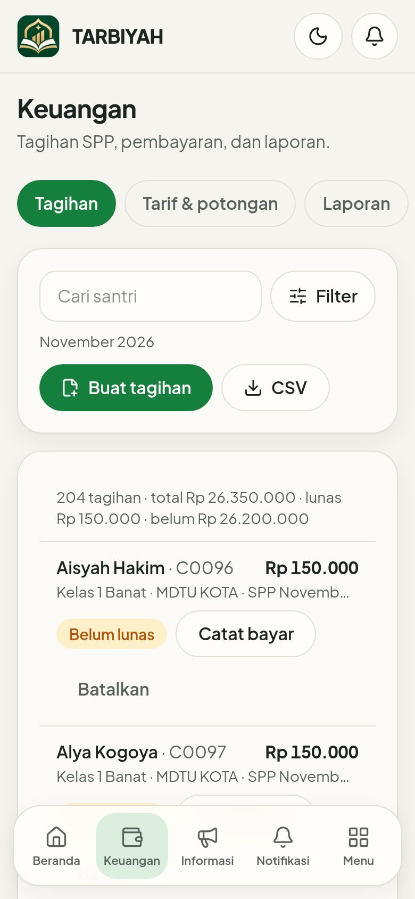 <b>Keuangan untuk bendahara</b></td>
    <td align="center"> <b>Dasbor kepala sekolah</b></td>
    <td align="center">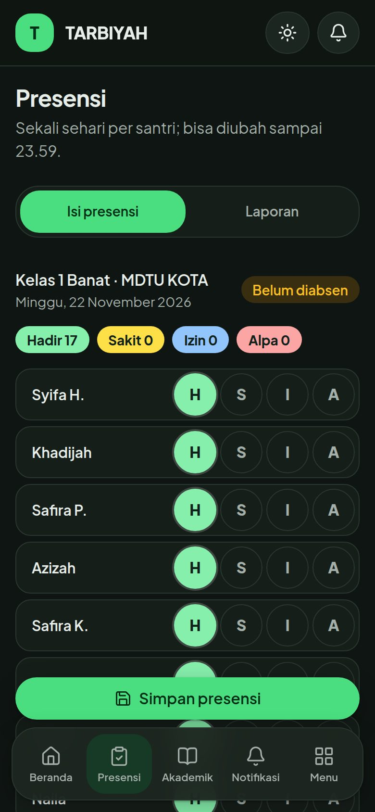 <b>Mode gelap</b></td>
  </tr>
</table>

  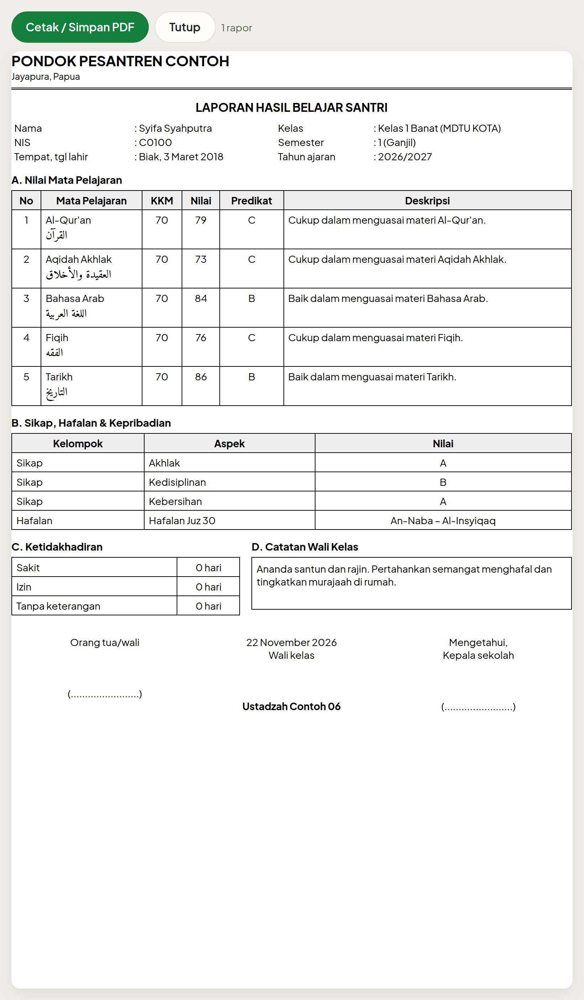 
  <b>Rapor</b>, siap dicetak atau disimpan sebagai PDF

  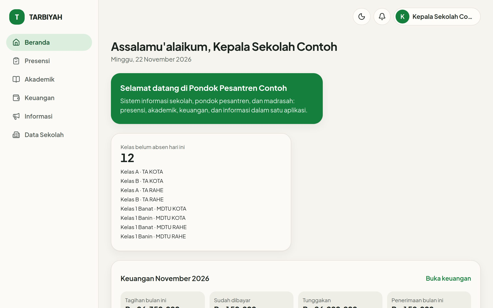 
  <b>Tampilan di komputer</b>

Semua gambar memakai data contoh, bukan data santri sungguhan.

## 📘 Panduan pengguna

Panduan bergambar dalam Bahasa Indonesia, siap dibagikan ke setiap pengguna. Klik nama berkas, lalu
tekan tombol unduh di GitHub.

| Panduan | Untuk |
| --- | --- |
| 📘 [**Manual Lengkap**](docs/manual/pdf/Manual-Lengkap-TARBIYAH.pdf) | Semua peran dalam satu berkas |
| 👨‍👩‍👧 [Panduan Wali Santri](docs/manual/pdf/Panduan-Wali-Santri.pdf) | Orang tua / wali santri |
| 👨‍🏫 [Panduan Guru dan Wali Kelas](docs/manual/pdf/Panduan-Guru-dan-Wali-Kelas.pdf) | Guru dan wali kelas |
| 💰 [Panduan Bendahara](docs/manual/pdf/Panduan-Bendahara.pdf) | Bendahara |
| 🏫 [Panduan Kepala Sekolah](docs/manual/pdf/Panduan-Kepala-Sekolah.pdf) | Kepala sekolah |
| ⚙️ [Panduan Admin](docs/manual/pdf/Panduan-Admin.pdf) | Admin / tata usaha |

## 🚀 Ingin memakai TARBIYAH?

TARBIYAH dipasang sekali di server milik lembaga, lalu dipakai bersama oleh seluruh guru, staf, dan
orang tua lewat browser atau aplikasi di HP. Yang dibutuhkan:

- **Server kecil (VPS)** dan **nama domain**, misalnya `app.sekolahanda.sch.id`;
- **Nomor WhatsApp sekolah** (opsional) untuk kirim bukti bayar dan kode lupa password;
- **Akun pembayaran QRIS** (opsional) bila ingin orang tua bisa membayar SPP dari HP.

Pemasangan cukup dilakukan sekali oleh orang yang terbiasa mengurus server, misalnya tim IT
yayasan atau relawan. Petunjuk teknisnya tersedia di [docs/DEPLOY.md](docs/DEPLOY.md). Setelah
terpasang, semua pengelolaan sehari-hari dilakukan dari dalam aplikasi, tanpa perlu keahlian
teknis.

## 🤝 Ikut mengembangkan

TARBIYAH terbuka untuk siapa saja yang ingin ikut membangun:

- **Menemukan masalah atau punya usulan fitur?** Tulis di [Issues](https://github.com/endyardhie/Tarbiyah/issues).
- **Pengembang?** Silakan fork, perbaiki, dan kirim pull request. Panduan teknis ada di
  [docs/PENGEMBANGAN.md](docs/PENGEMBANGAN.md).
- **Memakai TARBIYAH di lembaga Anda?** Ceritakan pengalaman Anda; masukan dari pengguna di lapangan
  sangat berharga.

## 🤲 Harapan

TARBIYAH dibuat agar lembaga pendidikan, terutama yang dikelola dengan sumber daya terbatas, bisa
menikmati sistem informasi yang rapi tanpa terbebani biaya. Semoga aplikasi ini bermanfaat bagi
para pendidik, santri, orang tua, dan masyarakat luas, serta menjadi amal jariyah bagi siapa saja
yang ikut memakai, menyebarkan, dan mengembangkannya.

## 📄 Lisensi

Dirilis dengan lisensi [MIT](LICENSE): bebas dipakai, diubah, dan dibagikan, termasuk untuk
keperluan lembaga, dengan tetap mencantumkan pemberitahuan hak cipta dan lisensi.
