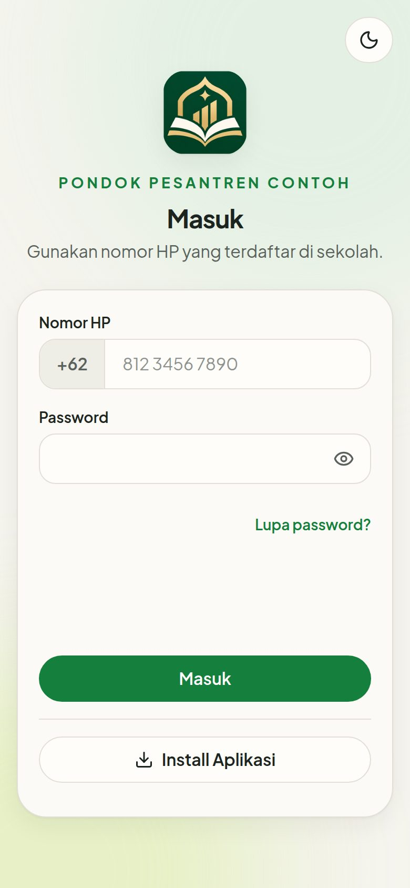
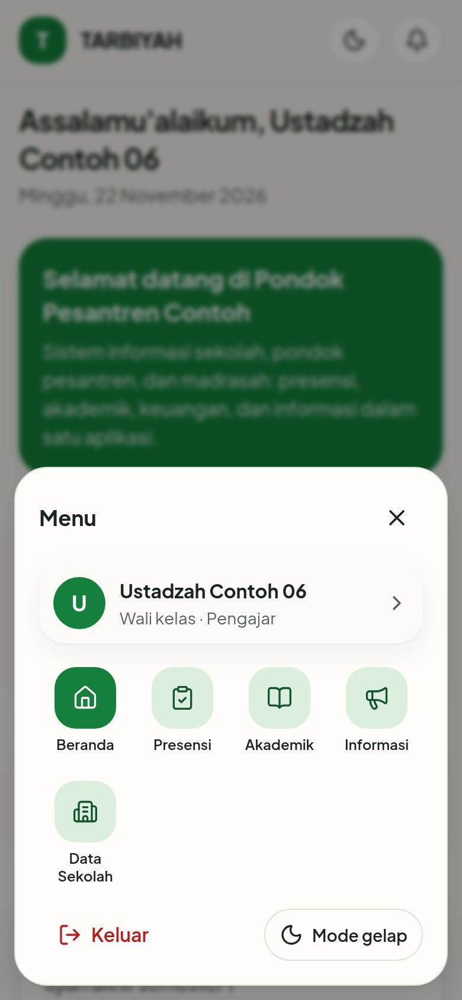
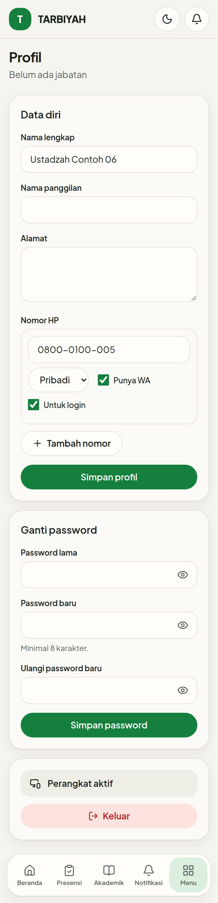
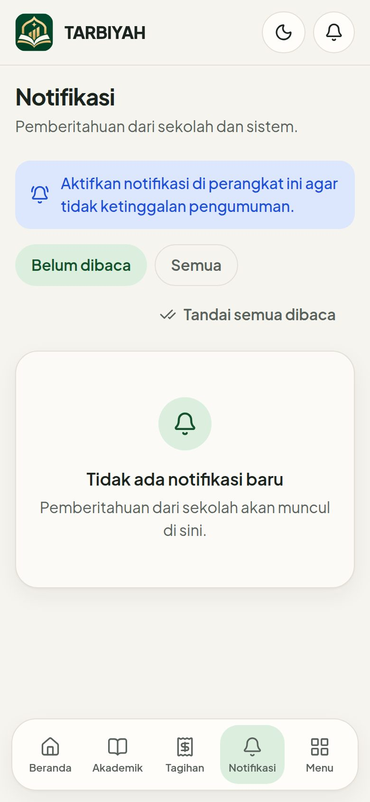
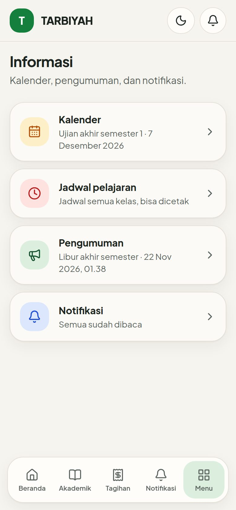
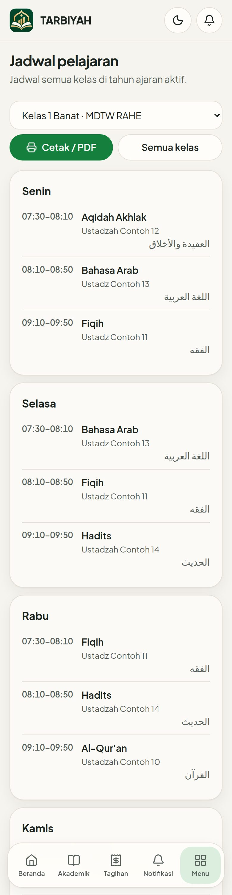
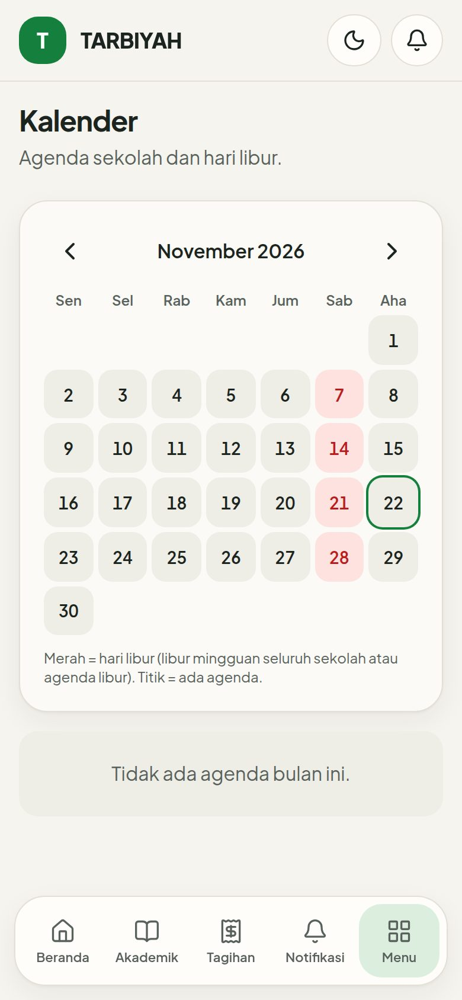
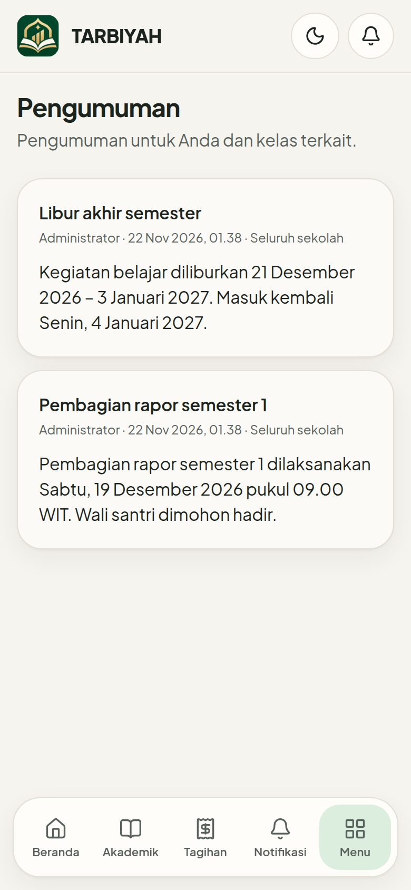

# Memulai (semua pengguna)

## Masuk ke aplikasi

1. Buka **https://tarbiyah.minhajussunnah.web.id** di Chrome (Android) atau Safari (iPhone).
2. Isi **Nomor HP** yang terdaftar di sekolah. Formatnya bebas: `0812…`, `+62812…`, atau
   `62812…`.
3. Isi **Password**. Pada masuk pertama, gunakan password sementara yang diberikan sekolah.
4. Tunggu centang verifikasi keamanan selesai, lalu tekan **Masuk**.
5. Pada masuk pertama, aplikasi meminta **Buat password baru** (minimal 8 karakter). Simpan
   password ini baik-baik.
6. Wali santri juga diminta membaca **Persetujuan data**, lalu mencentang persetujuan dan
   melanjutkan. Ini hanya sekali.

> **Lupa password?** Di halaman masuk tekan **Lupa password**, isi nomor HP, lalu **Kirim kode**.
> Kode 6 angka dikirim lewat WhatsApp sekolah. Isi kodenya beserta password baru. Bila WhatsApp
> sekolah sedang tidak aktif, minta admin me-reset password Anda.

## Pasang aplikasi di layar utama HP

Setelah dipasang, TARBIYAH terbuka seperti aplikasi biasa, tanpa bilah alamat browser.

- **Android (Chrome):** di halaman masuk tekan **Install Aplikasi**, lalu **Instal**. Bila tombol
  itu tidak ada, buka menu Chrome (titik tiga ⋮) › **Instal aplikasi** atau **Tambahkan ke layar
  utama**.
- **iPhone (Safari):** tekan **Cara Install Aplikasi** untuk petunjuknya: ketuk tombol **Bagikan**
  (kotak dengan panah ke atas) › **Tambah ke Layar Utama** › **Tambah**.

## Mengenal tampilan

 

- **Navbar bawah** berisi menu yang paling sering dipakai sesuai peran Anda. Item paling kanan,
  **Menu**, membuka semua menu lainnya beserta kartu profil Anda.
- **Ikon bulan/matahari** di kanan atas mengganti tampilan terang/gelap.
- **Ikon lonceng** membuka Notifikasi; angka merah menunjukkan jumlah yang belum dibaca.
- **Keluar**: **Menu › Keluar**.

## Profil, password, dan perangkat

Buka **Menu**, lalu ketuk kartu nama Anda di bagian atas.

- **Data diri**: nama lengkap, nama panggilan, alamat, dan nomor HP. Tekan **Simpan** setelah
  mengubah.
- **Ganti password**: isi password lama dan password baru.
- **Perangkat aktif**: daftar HP/komputer yang sedang masuk dengan akun Anda. Keluarkan perangkat
  yang tidak Anda kenali, misalnya HP yang hilang.

## Notifikasi

Notifikasi berisi pemberitahuan PR baru, nilai, dan pengumuman dari sekolah.

Agar pemberitahuan muncul di HP walau aplikasi tertutup, buka **Notifikasi › Aktifkan
notifikasi**, tekan **Aktifkan**, lalu pilih **Izinkan** saat browser bertanya. Di iPhone,
notifikasi hanya bisa aktif setelah aplikasi dipasang di layar utama (lihat di atas).

## Informasi: pengumuman, kalender, dan jadwal

 

Menu **Informasi** berisi:

- **Kalender**: agenda sekolah dan hari libur.
- **Jadwal pelajaran**: jadwal semua kelas. Pilih kelas di atas. Tekan **Cetak / PDF** untuk
  mencetak atau menyimpan jadwal kelas itu, atau **Semua kelas** untuk mencetak semuanya (satu
  kelas per halaman).
- **Pengumuman**: pengumuman dari sekolah dan guru.
- **Notifikasi**: kotak masuk Anda.

 
