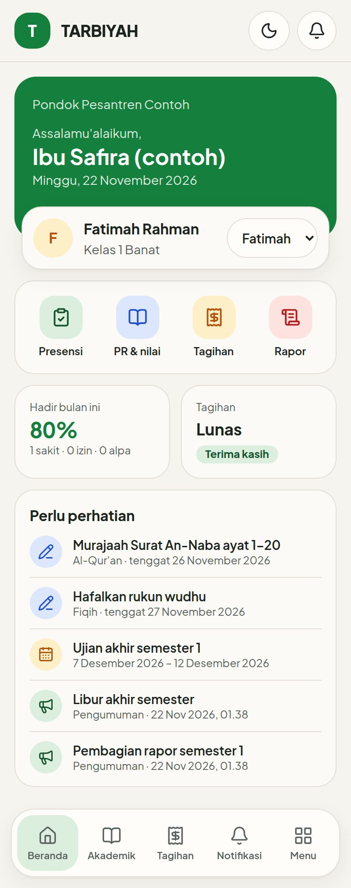
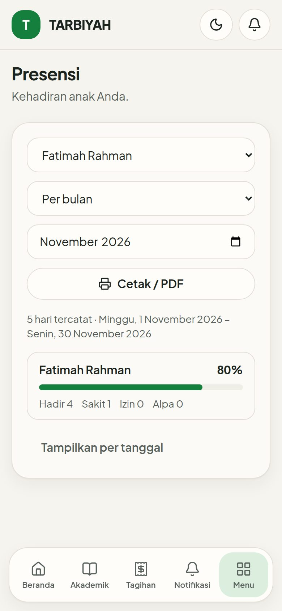
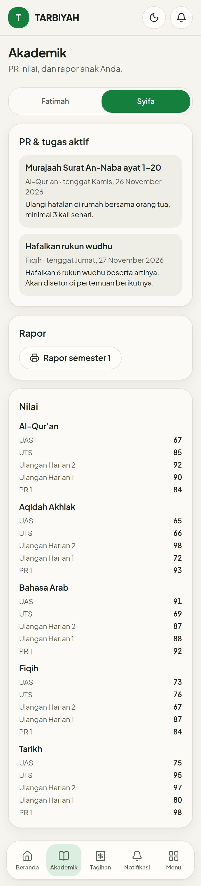
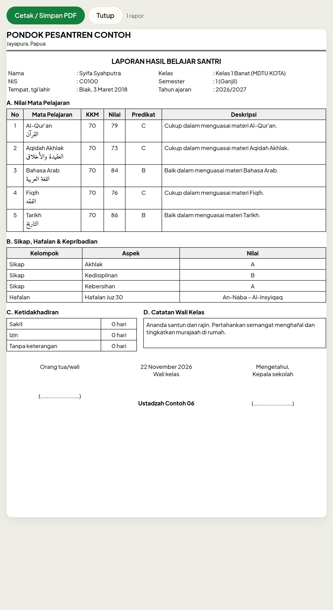
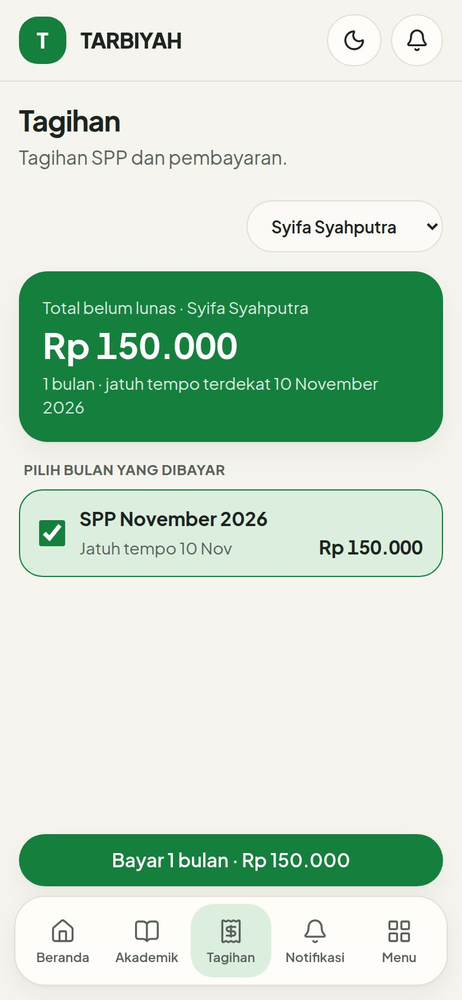
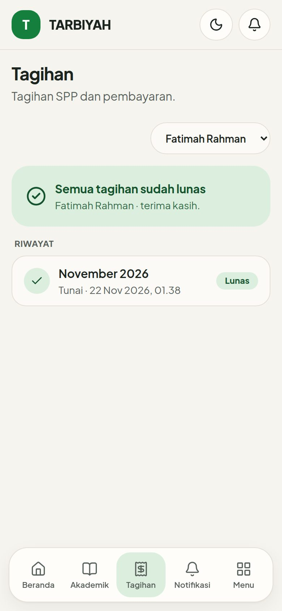

# Panduan Wali Santri

Navbar bawah wali santri: **Beranda**, **Akademik**, **Tagihan**, **Notifikasi**, dan **Menu**.
Bila Anda punya lebih dari satu anak di sekolah ini, semua anak ada di satu akun; pilih nama anak
di bagian atas tiap halaman.

## Beranda

- **Kartu anak**: nama dan kelas. Ganti anak lewat pilihan nama di sebelah kanan.
- **Tombol cepat**: Presensi, PR & nilai, Tagihan, dan Rapor.
- **Hadir bulan ini**: persentase kehadiran anak bulan ini beserta jumlah sakit, izin, dan alpa.
- **Tagihan**: total yang belum dibayar, atau "Lunas".
- **Perlu perhatian**: PR yang belum lewat tenggat, agenda terdekat, dan pengumuman terbaru.
  Ketuk salah satunya untuk melihat detail.

## Presensi anak

Buka **Menu › Presensi** (atau tombol **Presensi** di Beranda).

1. Pilih nama anak.
2. Pilih **Per bulan** atau **Per semester**, lalu bulan/semesternya.
3. Terlihat jumlah **Hadir (H)**, **Sakit (S)**, **Izin (I)**, dan **Alpa (A)**. Tekan **Tampilkan
   per tanggal** untuk melihat status setiap hari.
4. **Cetak / PDF** untuk menyimpan rekapnya.

Presensi diisi wali kelas setiap hari dan masih bisa dikoreksi sampai pukul 23.59 di hari yang
sama.

## PR, nilai, dan rapor

Buka **Akademik**, lalu pilih nama anak.

- **PR & tugas aktif**: judul, mapel, tenggat, petunjuk dari guru, dan lampiran bila ada.
- **Nilai**: nilai setiap penilaian (PR, ulangan harian, UTS, UAS) per mata pelajaran.
- **Rapor**: tombol rapor muncul **setelah rapor dinyatakan final** oleh sekolah. Tekan tombolnya
  untuk melihat rapor, lalu **Cetak / Simpan PDF** untuk menyimpan atau mencetaknya.

> Rapor yang masih dalam pengisian (draft) tidak bisa dibuka wali santri. Bila tombol rapor belum
> muncul, berarti rapor belum final.

## Tagihan dan pembayaran SPP

 

Buka **Tagihan**.

- Kartu hijau di atas menunjukkan **total belum lunas**, jumlah bulan, dan jatuh tempo terdekat.
- **Riwayat** di bawah berisi pembayaran yang sudah lunas.

### Bayar dengan QRIS (dari HP)

1. Pilih nama anak (bila lebih dari satu).
2. Centang bulan yang ingin dibayar di **Pilih bulan yang dibayar**. Boleh lebih dari satu bulan.
3. Tekan tombol **Bayar … bulan · Rp …** di bagian bawah.
4. Muncul **kode QRIS**. Bayar dengan aplikasi e-wallet atau mobile banking apa pun yang mendukung
   QRIS (GoPay, OVO, DANA, ShopeePay, m-banking, dan lainnya):
   - di HP lain: pindai QR di layar;
   - di HP yang sama: simpan/tangkap layar QR, lalu unggah dari galeri di aplikasi pembayaran.
5. Bayar **tepat sesuai nominal** yang tertera.
6. Biarkan halaman terbuka. Setelah pembayaran diterima, muncul **Pembayaran diterima**, tagihan
   otomatis lunas, dan **bukti bayar dikirim ke WhatsApp** Anda.

> Kode QRIS punya batas waktu. Bila sudah kedaluwarsa, tutup lalu tekan **Bayar** lagi untuk
> membuat kode baru. Jangan membayar kode yang sudah kedaluwarsa.

### Bayar tunai atau transfer

Bayar langsung ke bendahara sekolah. Bendahara mencatatnya di aplikasi; status tagihan menjadi
lunas dan bukti bayar dikirim ke WhatsApp Anda.

Bila muncul tulisan *Pembayaran online belum tersedia*, artinya sekolah belum membuka pembayaran
QRIS; silakan bayar ke bendahara.

## Pengumuman, kalender, dan jadwal

Buka **Menu › Informasi** untuk melihat pengumuman, kalender libur & agenda, serta jadwal pelajaran
kelas anak Anda. Lihat bab *Memulai* untuk penjelasannya.
