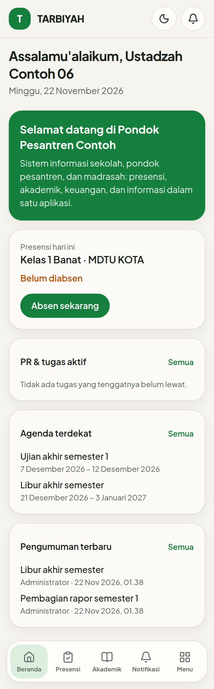
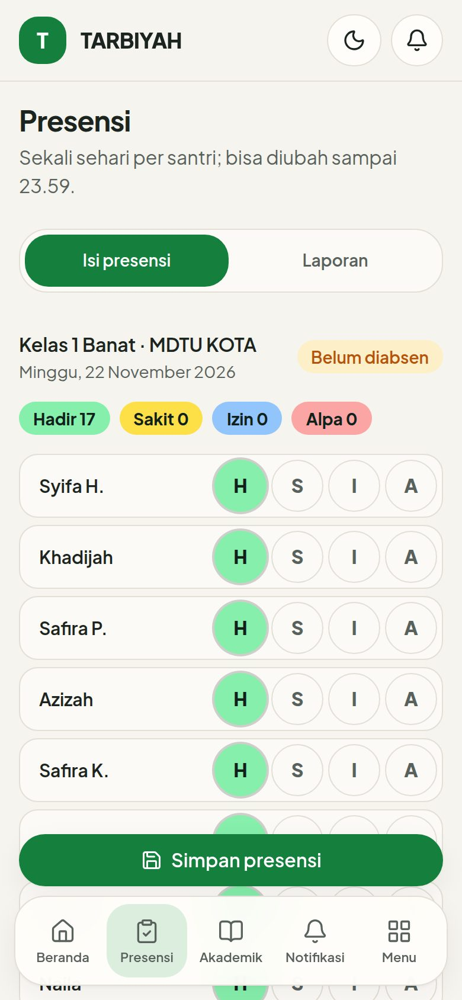
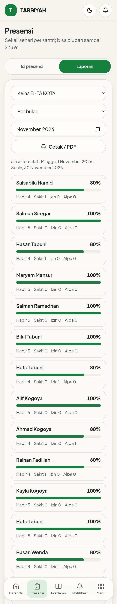
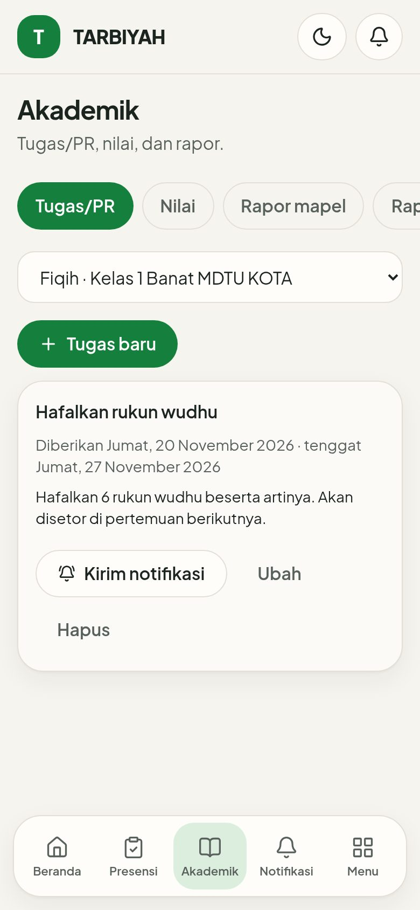
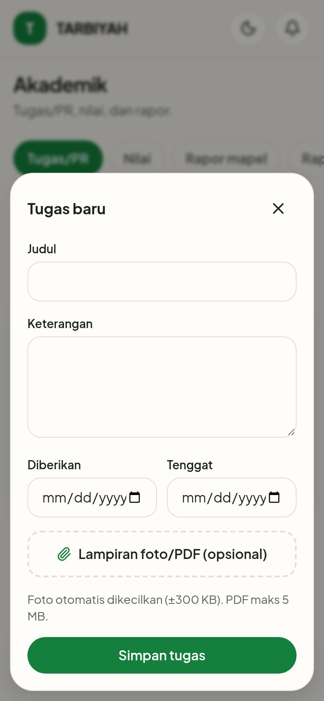
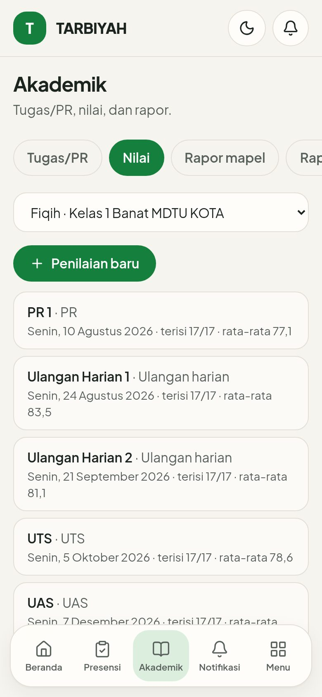
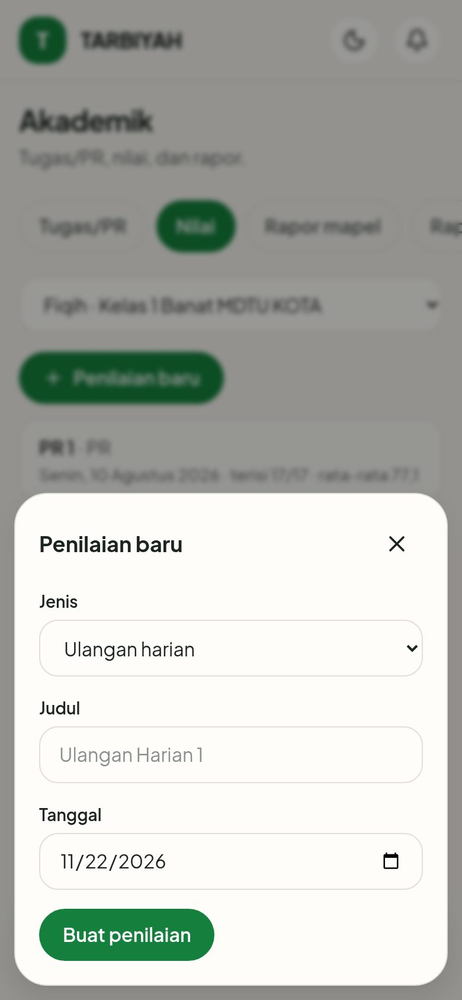
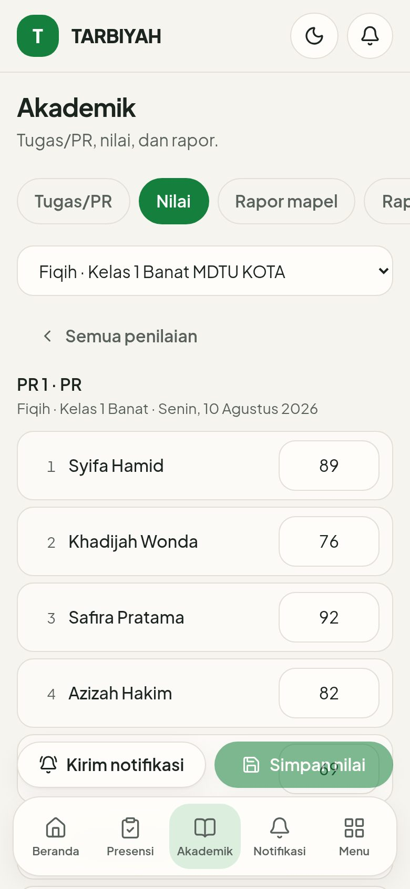
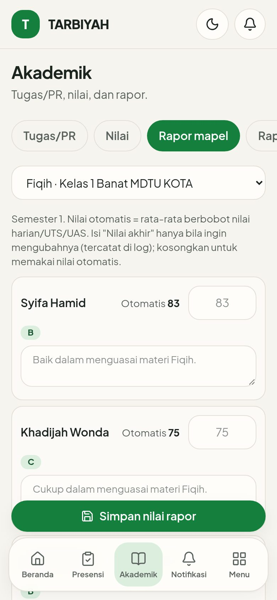
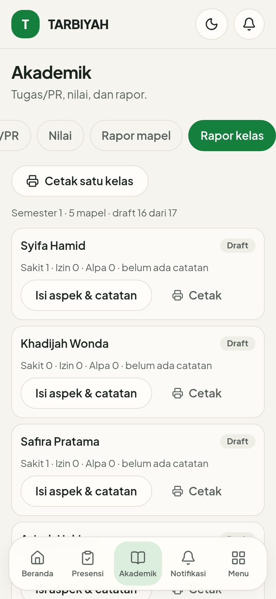

# Panduan Guru dan Wali Kelas

Bab ini untuk **guru pengajar** (memberi PR, mengisi nilai, dan rapor mapel) dan **wali kelas**
(presensi harian dan rapor kelas). Seorang guru bisa sekaligus wali kelas; menunya bergabung
otomatis.

Navbar bawah: **Beranda**, **Presensi**, **Akademik**, **Notifikasi**, dan **Menu**.

## Beranda

Beranda menampilkan status presensi kelas Anda hari ini, ringkasan kehadiran, agenda terdekat,
dan pengumuman terbaru.

## Presensi harian (wali kelas)

 

1. Buka **Presensi**, tab **Isi presensi**. Kelas Anda dan tanggal hari ini sudah terpilih (bila
   Anda wali beberapa kelas, pilih kelasnya).
2. Setiap santri ditampilkan dengan **nama panggilan** dalam satu baris. Bila ada nama panggilan
   yang sama di kelas, aplikasi menambahkan huruf awal nama kedua (misalnya *Syifa H.*).
3. Semua santri awalnya **H (Hadir)**. Ubah yang tidak hadir: **S** sakit, **I** izin, **A** alpa
   (tanpa keterangan). Untuk S dan I bisa ditambah keterangan singkat.
4. Tekan **Simpan presensi**. Status di atas berubah dari *Belum diabsen* menjadi sudah terisi.

> Presensi hari ini masih bisa diubah sampai pukul **23.59**. Koreksi tanggal yang sudah lewat
> hanya bisa dilakukan oleh pemegang izin koreksi (biasanya admin) dan tercatat di log.
> Pada hari libur, halaman presensi menampilkan keterangan libur dan tidak perlu diisi.

**Laporan:** tab **Laporan** menampilkan rekap per bulan atau per semester untuk satu kelas, lengkap
dengan persentase hadir. Tekan **Tampilkan per tanggal** untuk rincian harian, dan **Cetak / PDF**
untuk mencetak rekap (A4 mendatar).

## PR dan tugas (guru)

 

1. Buka **Akademik**, tab **Tugas/PR**, lalu pilih mapel dan kelas di daftar pilihan. Daftar ini
   menyebut unit dan lokasi, misalnya *Fiqih · Kelas 1 Banat MDTU KOTA*; pastikan memilih yang
   benar.
2. Tekan **Tugas baru**, isi **Judul**, petunjuk, tanggal **Diberikan**, dan **Tenggat**.
3. Bila perlu, tambahkan **lampiran** foto atau PDF (foto otomatis dikecilkan; PDF maksimal 5 MB).
4. Simpan. Wali santri kelas itu melihat tugas di **Akademik** dan **Beranda** mereka.

Tugas bisa diubah atau dihapus dari daftar tugas. Tombol **Kirim notifikasi** mengirim
pemberitahuan ke wali santri kelas itu.

## Mengisi nilai (guru)

 

1. Buka **Akademik › Nilai**, pilih mapel dan kelas.
2. Tekan **Penilaian baru**, pilih **Jenis** (PR, ulangan harian, UTS, UAS, praktik, …), isi
   **Judul**, dan **Tanggal** (otomatis hari ini), lalu simpan.
3. Ketuk penilaian itu untuk membuka daftar santri.

4. Ketik nilai **0–100** untuk setiap santri. Tekan **Enter** di keyboard untuk pindah ke santri
   berikutnya. Santri yang belum ikut boleh dikosongkan dulu.
5. Tekan **Simpan nilai**. Lalu, bila ingin, **Kirim notifikasi** agar wali santri tahu nilai
   sudah keluar.

> Ikon gembok di samping nama berarti rapor santri itu sudah **final**; nilainya tidak bisa diubah
> lagi kecuali kunci rapor dibuka oleh kepala sekolah.

## Rapor mapel (guru)

Buka **Akademik › Rapor mapel**, pilih mapel dan kelas.

- **Nilai otomatis** dihitung dari rata-rata berbobot semua penilaian semester ini (bobot PR,
  ulangan, UTS, dan UAS diatur admin). Predikat (A/B/C/D) dan deskripsi ikut otomatis.
- Isi **Nilai akhir** hanya bila ingin mengganti nilai otomatis (perubahan tercatat di log).
  Kosongkan untuk memakai nilai otomatis.
- Isi **deskripsi** bila ingin mengganti deskripsi otomatis.
- Tekan **Simpan nilai rapor**.

## Rapor kelas (wali kelas)

Buka **Akademik › Rapor kelas**. Daftar santri menunjukkan status rapor (**Draft** atau **Final**),
jumlah sakit/izin/alpa, dan apakah catatan sudah diisi.

1. Tekan **Isi aspek & catatan** pada seorang santri.
2. Isi nilai aspek (sikap, kedisiplinan, kebersihan, hafalan, dan lainnya sesuai pengaturan
   sekolah), **Catatan wali kelas**, dan pada semester genap **Keputusan** naik/tinggal kelas.
3. Simpan.
4. Tekan **Cetak** untuk melihat rapor satu santri, atau **Cetak satu kelas** untuk semua rapor
   kelas sekaligus. Rapor yang belum final bertanda **DRAFT**.

Setelah semua nilai mapel dan catatan lengkap, kepala sekolah **mengunci** rapor (final). Sejak
itu wali santri bisa melihat dan mencetak rapor anaknya.

## Jika Anda juga orang tua santri

Guru atau wali kelas yang anaknya bersekolah di sini melihat tab **Anak saya** di **Presensi** dan
**Akademik**, untuk presensi, PR, nilai, dan rapor anak sendiri. Tagihan anak ada di **Menu ›
Keuangan**.
