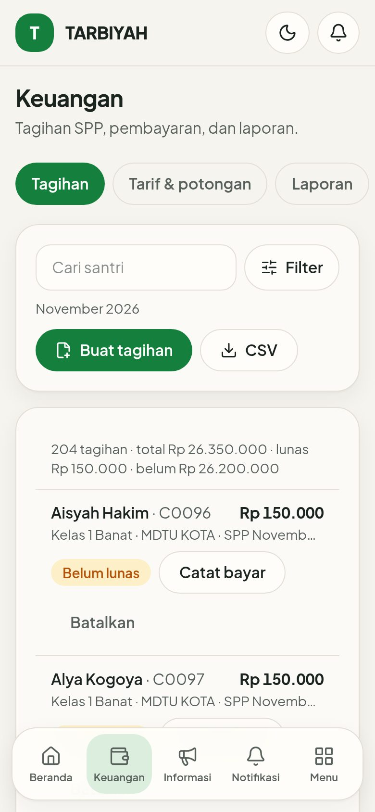
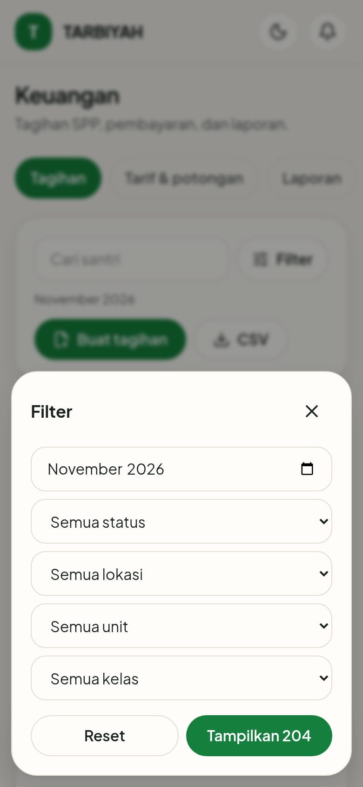
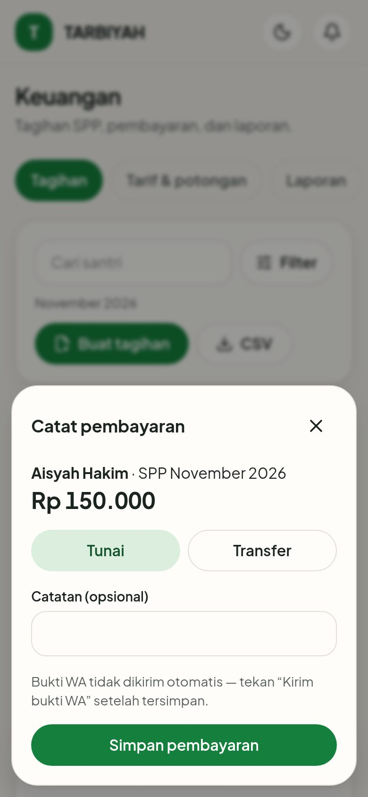
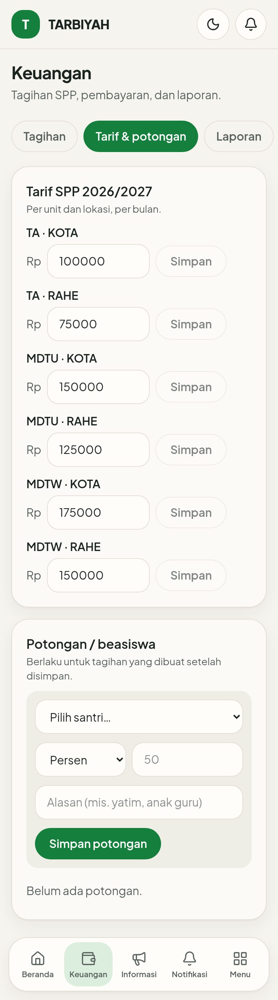
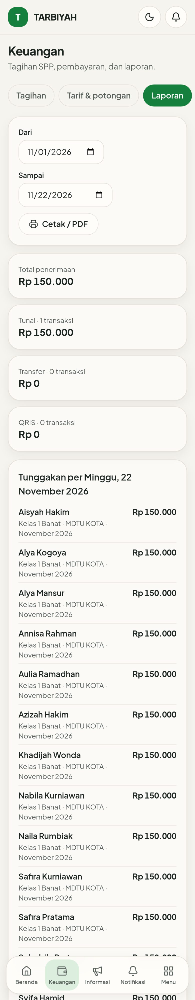
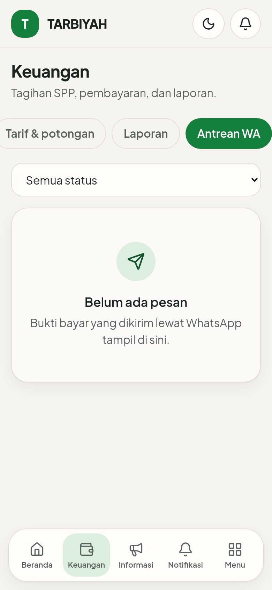

# Panduan Bendahara

Navbar bawah bendahara: **Beranda**, **Keuangan**, **Informasi**, **Notifikasi**, dan **Menu**.
Menu **Keuangan** punya empat tab: **Tagihan**, **Tarif & potongan**, **Laporan**, dan
**Antrean WA**.

## Bagaimana tagihan dibuat

- Tagihan SPP dibuat **otomatis setiap tanggal 1 pukul 03.00** untuk semua santri aktif, sesuai
  tarif unit + lokasi dan potongan masing-masing santri. Bulan apa saja yang ditagih dan tanggal
  jatuh temponya diatur admin di Pengaturan.
- Bila tagihan bulan ini belum ada (misalnya server sempat mati), tekan **Buat tagihan**, pilih
  bulannya, periksa pratinjau, lalu buat. Tagihan yang sudah ada tidak akan dobel.
- Santri yang lulus atau pindah tidak lagi ditagih.

## Daftar tagihan

 

1. Buka **Keuangan › Tagihan**. Ringkasan di atas daftar menunjukkan jumlah tagihan, total, yang
   sudah lunas, dan yang belum.
2. Cari santri lewat kolom **Cari santri** (nama atau NIS).
3. Tekan **Filter** untuk memilih **periode** (bulan), **status** (belum lunas/lunas/dibatalkan),
   **lokasi**, **unit**, dan **kelas**. **Reset** mengosongkan filter; **Tampilkan** menutup
   lembar filter.
4. **CSV** mengunduh daftar sesuai filter untuk diolah di Excel.

## Mencatat pembayaran tunai atau transfer

1. Cari tagihannya, lalu tekan **Catat bayar**.
2. Pilih **Tunai** atau **Transfer**, isi catatan bila perlu (misalnya nama bank), lalu **Simpan
   pembayaran**. Tagihan langsung berstatus **Lunas**.
3. Tekan **Kirim bukti WA** pada tagihan itu agar bukti bayar terkirim ke WhatsApp wali. Bila
   perlu mengirim lagi, tekan **Kirim ulang bukti**.

Pembayaran **QRIS** dari wali tidak perlu dicatat: tagihan lunas otomatis dan bukti WA terkirim
sendiri.

**Membatalkan tagihan** (misalnya santri keluar sebelum bulan itu): tekan **Batalkan** dan isi
alasannya. Tagihan yang dibatalkan tidak dihapus; tetap tercatat dengan alasannya.

## Tarif dan potongan

- **Tarif SPP** ditetapkan per unit dan lokasi untuk tahun ajaran aktif. Ubah angkanya, lalu
  simpan. Perubahan tarif berlaku untuk tagihan yang dibuat **sesudahnya**; tagihan yang sudah ada
  tidak berubah.
- **Potongan** (beasiswa, yatim, anak guru, dan sebagainya) diberikan per santri, dalam persen
  atau rupiah, dengan alasan. Potongan 100% berarti santri itu tidak ditagih.

## Laporan keuangan

Buka **Keuangan › Laporan**, pilih tanggal **Dari** dan **Sampai**.

- **Total penerimaan** per metode (tunai, transfer, QRIS) dan daftar **Pembayaran masuk**.
- **Tunggakan** per santri yang sudah lewat jatuh tempo.
- **Cetak / PDF** untuk laporan resmi (A4).
- **Perlu dicek**: pembayaran QRIS yang **nominalnya tidak cocok** atau **bayar ganda**. Cocokkan
  dengan mutasi di aplikasi merchant QRIS, selesaikan dengan wali (misalnya mengembalikan
  kelebihan), lalu tekan **Tandai sudah dicek** dan isi **Catatan hasil pemeriksaan**.

## Antrean WhatsApp

Semua pesan WhatsApp (bukti bayar, kode lupa password, dan lainnya) dikirim bergiliran oleh
sistem. Tab **Antrean WA** menunjukkan status tiap pesan: **Terkirim**, menunggu, **Gagal**, atau
**Dilewati** (bila WA gateway sedang dimatikan).

Pesan yang gagal atau dilewati bisa dikirim lagi dengan **Kirim ulang** setelah masalahnya beres
(misalnya nomor WA sekolah sudah tersambung kembali). Bila banyak pesan gagal, hubungi admin.
