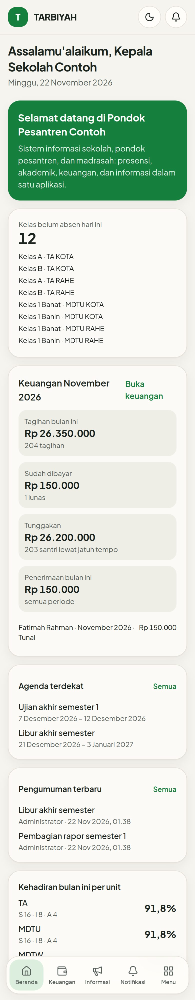
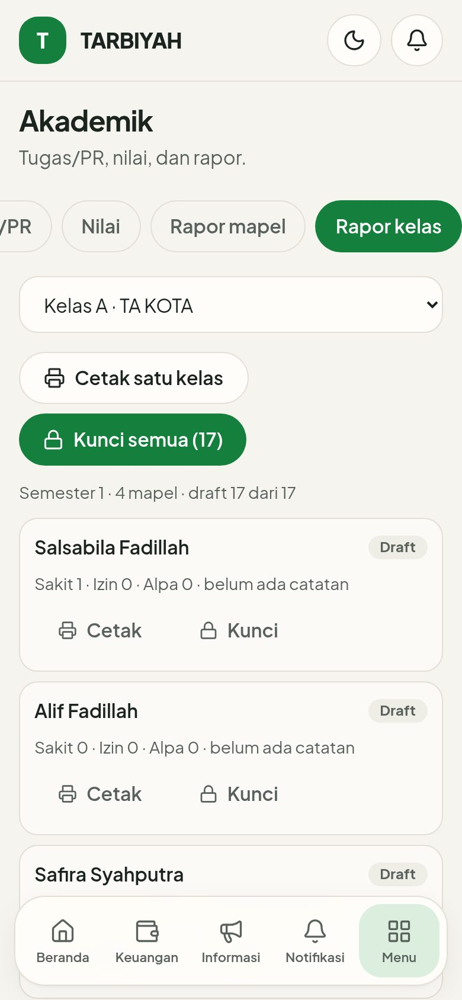
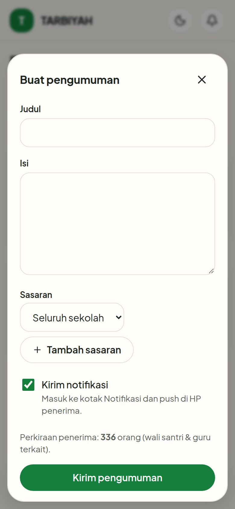

# Panduan Kepala Sekolah

Kepala sekolah bisa **melihat semua unit dan lokasi**: presensi, PR, nilai, rapor, dan laporan
keuangan. Tugas utamanya di aplikasi: memantau, **mengunci rapor (final)**, mengirim pengumuman,
dan mengelola kalender.

## Beranda (dasbor)

- **Kelas belum absen hari ini**: kelas yang presensinya belum diisi wali kelas.
- **Keuangan bulan ini**: total tagihan, yang sudah dibayar, tunggakan, dan penerimaan, beserta
  pembayaran terakhir. **Buka keuangan** untuk rinciannya.
- **Agenda terdekat** dan **pengumuman terbaru**.
- **Kehadiran bulan ini per unit**: persentase hadir beserta jumlah sakit, izin, dan alpa.

## Memantau presensi dan akademik

- **Presensi › Laporan**: pilih kelas mana pun, per bulan atau per semester, lalu **Cetak / PDF**
  bila perlu.
- **Akademik**: semua mapel dan kelas bisa dilihat (bertanda *lihat*), termasuk tugas, nilai, dan
  rapor mapel.
- **Informasi › Jadwal pelajaran**: jadwal semua kelas, bisa dicetak sekaligus.

## Mengunci rapor (final)

Rapor dikunci setelah semua guru mengisi nilai rapor mapel dan wali kelas mengisi aspek serta
catatan.

1. Buka **Akademik › Rapor kelas**, pilih kelas.
2. Periksa rapor: **Cetak** untuk satu santri atau **Cetak satu kelas** untuk semuanya (masih
   bertanda DRAFT).
3. Tekan **Kunci** pada satu santri, atau **Kunci semua** untuk seluruh kelas, lalu konfirmasi.
4. Rapor menjadi **Final**: wali santri bisa melihat dan mencetaknya, dan nilai tidak bisa diubah
   lagi.

> Ada yang perlu diperbaiki setelah final? Tekan **Buka kunci** pada santri itu; rapornya kembali
> menjadi draft. Setelah diperbaiki, kunci kembali. Semua kunci dan buka kunci tercatat di log.

## Pengumuman

1. Buka **Informasi › Pengumuman**, tekan **Buat pengumuman**.
2. Isi **Judul** dan **Isi**.
3. Pilih **Sasaran**: seluruh sekolah, atau unit/lokasi/kelas tertentu. Tekan **Tambah sasaran**
   untuk beberapa sasaran sekaligus. Aplikasi menampilkan perkiraan jumlah penerima.
4. Biarkan **Kirim notifikasi** tercentang agar pengumuman masuk ke kotak Notifikasi dan muncul
   di HP penerima.
5. Tekan **Kirim pengumuman**.

## Kalender dan hari libur

Buka **Informasi › Kalender** untuk menambah agenda (ujian, rapat, kegiatan) atau **hari libur**.
Agenda yang ditandai libur membuat presensi pada tanggal itu tidak perlu diisi. Pilih sasaran
seperti pada pengumuman.

## Laporan keuangan

**Menu › Keuangan** menampilkan tagihan dan laporan (penerimaan per metode, tunggakan) untuk
dilihat. Pencatatan pembayaran dilakukan oleh bendahara.
