# Panduan Admin

Admin (tata usaha/operator) memegang semua menu, termasuk **Data Sekolah** dan **Sistem**. Buat
minimal **dua admin** agar sistem tidak bergantung pada satu orang.

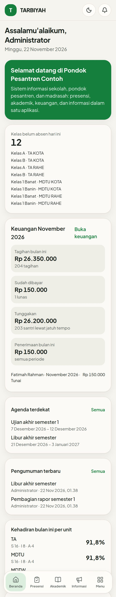 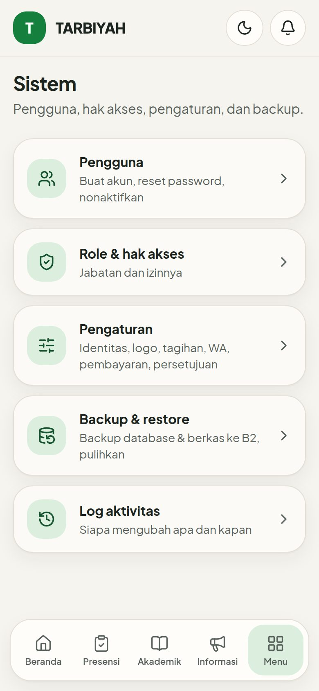

## Setup awal (urutan yang disarankan)

1. **Sistem › Pengaturan**: identitas lembaga (nama dipakai juga untuk konfirmasi restore), logo
   (ikon aplikasi dibuat otomatis), tagihan SPP (bulan yang ditagih, tanggal jatuh tempo, template
   pesan bukti bayar), WA gateway, payment gateway, dan teks persetujuan data wali.
2. **Data Sekolah › Lokasi, unit & tahun ajaran**: lokasi (mis. KOTA, RAHE), unit (TA, MDTU,
   MDTW, …), tahun ajaran dan semester, lalu **aktifkan** yang berjalan. Atur libur mingguan.
3. **Sistem › Pengguna**: akun guru dan staf, lalu beri **jabatan** (Kepala Sekolah, Bendahara, …).
   Hak tiap jabatan diatur di **Sistem › Role & hak akses**.
4. **Data Sekolah › Kelas**: kelas per unit dan lokasi, tingkat, dan wali kelas.
5. **Data Sekolah › Mata pelajaran**, lalu **Pengajaran & jadwal**: guru per mapel per kelas, dan
   jam pelajarannya.
6. **Santri dan wali**: lewat **Impor CSV** atau satu per satu.
7. **Keuangan › Tarif & potongan**: tarif SPP per unit + lokasi dan potongan per santri.

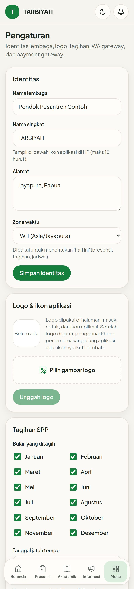

## Data sekolah

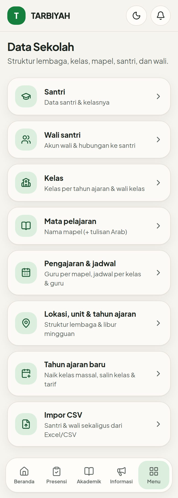 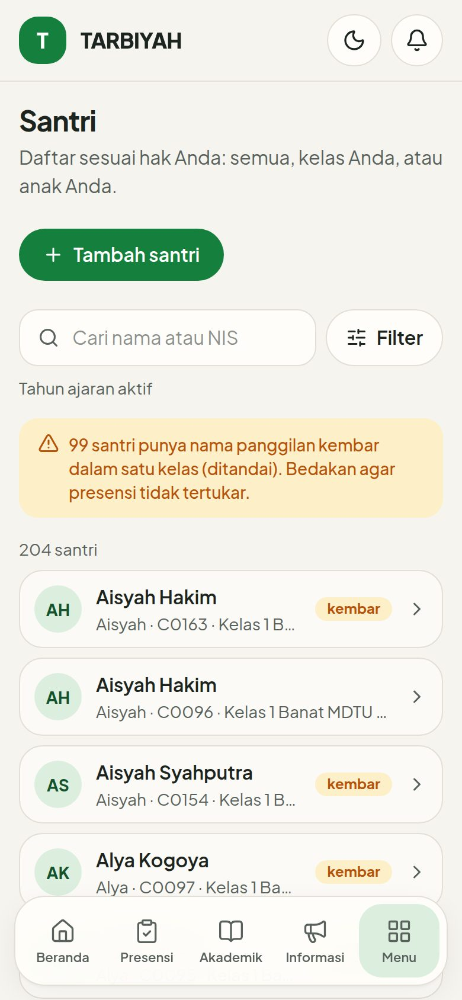

- **Santri**: cari, filter per tahun ajaran dan kelas, tambah, dan ubah. Santri dengan nama
  panggilan kembar di satu kelas ditandai *kembar*; bedakan agar presensi tidak tertukar.
- **Wali santri**: satu akun per orang (ayah dan ibu sebaiknya terpisah). Pada data santri, tekan
  **Hubungkan wali** untuk memilih akun yang sudah ada, termasuk akun guru/staf yang juga orang
  tua santri, atau **Wali baru**.
- **Kelas**: per tahun ajaran, dengan wali kelasnya.
- **Pengajaran & jadwal**: satu baris = satu guru mengajar satu mapel di satu kelas. Pilihan guru
  berisi guru/staf, lalu wali santri (bertanda *· wali nama anak*), karena orang tua santri boleh
  ikut mengajar. Satu mapel di satu kelas hanya punya satu pengajar; untuk mengganti guru, tekan
  **Ubah** pada mapel itu.

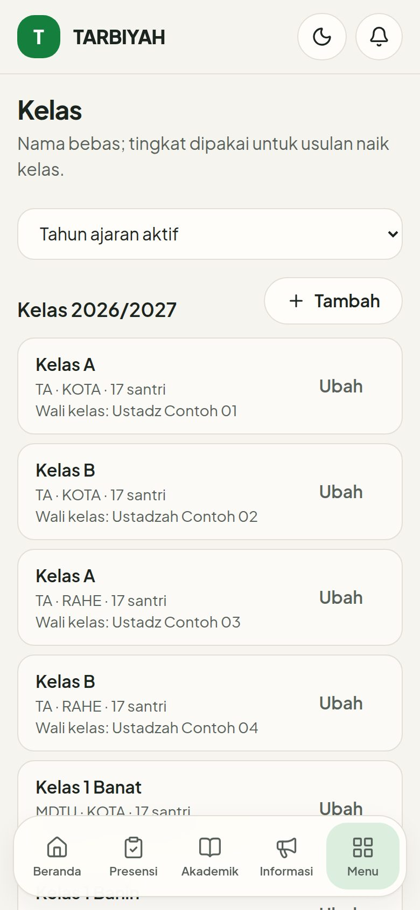 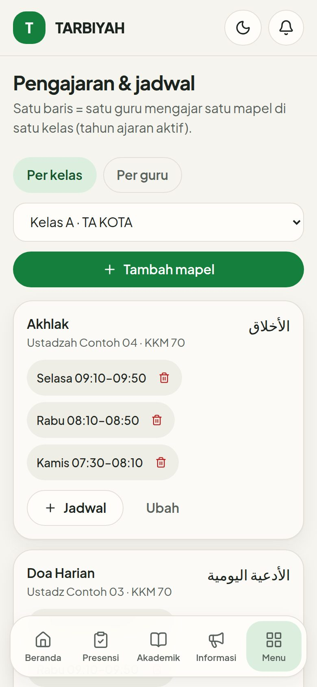

## Peran ganda dalam satu akun

Satu orang cukup **satu akun** (satu nomor HP). Perannya digabung:

- jabatan (Kepala Sekolah, Bendahara, …) di **Pengguna**;
- wali kelas di **Kelas**; pengajar di **Pengajaran**;
- orang tua santri lewat **Hubungkan wali** di data santri.

Menunya bergabung otomatis. Guru yang juga orang tua mendapat tab **Anak saya** di Presensi dan
Akademik.

## Impor CSV santri dan wali

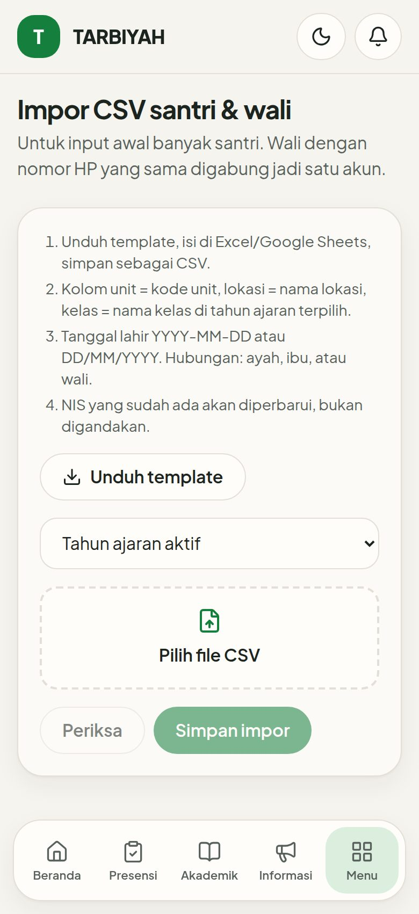

1. **Data Sekolah › Impor CSV › Unduh template**.
2. Isi di Excel/Google Sheets. Kolom: `nis, nama, nama_panggilan, jenis_kelamin (L/P),
   tempat_lahir, tanggal_lahir, alamat, unit, lokasi, kelas, wali1_nama, wali1_hubungan
   (ayah/ibu/wali), wali1_hp, wali2_nama, wali2_hubungan, wali2_hp`. `unit`, `lokasi`, dan `kelas`
   harus sama persis dengan yang sudah dibuat.
3. **Penting di Excel:** format kolom **wali1_hp** dan **wali2_hp** sebagai **Teks** sebelum
   mengetik nomor. Bila tidak, Excel mengubah nomor menjadi `8,12E+10` dan nomornya rusak (aplikasi
   akan menolaknya). Tanggal lahir boleh `2017-03-21` atau `21/03/2017`.
4. Simpan sebagai **CSV**, unggah, lalu periksa pratinjau. Baris bermasalah ditandai beserta
   alasannya; impor ditolak sampai semua baris benar.
5. Impor, lalu unduh berkas **password sementara wali** dan bagikan satu per satu (jangan di grup).
   Kakak-adik dengan nomor wali yang sama otomatis memakai satu akun wali.

## Akun dan password

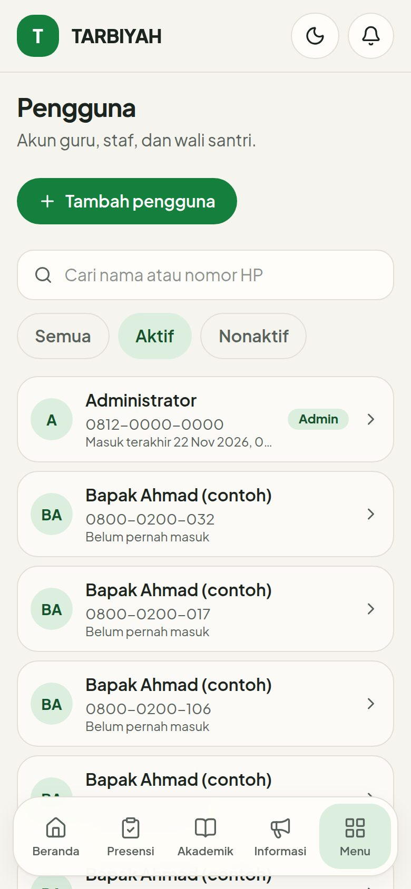

- Login memakai nomor HP dalam format apa pun.
- Lupa password: pengguna bisa reset sendiri lewat kode WhatsApp, atau admin menekan **Reset
  password** di Pengguna/Wali. Berikan password sementara langsung ke orangnya.
- Pengguna yang keluar: **nonaktifkan** (data tidak pernah dihapus). Admin aktif terakhir tidak
  bisa dinonaktifkan.

## WhatsApp dan pembayaran online

- **WA gateway (GOWA)**: aktifkan, isi URL internal (mis. `http://gowa:3000`), user dan password,
  Device ID bila GOWA memegang lebih dari satu nomor, serta jeda kirim. Tekan **Cek koneksi**.
  Bila nomor WA sekolah logout, pindai ulang QR di GOWA.
- **Payment gateway (noken-pay)**: aktifkan, isi URL internal, API key, secret webhook, dan URL
  webhook internal bila perlu. Uji dengan satu pembayaran kecil sebelum diumumkan ke wali.

## Tahun ajaran baru (naik kelas)

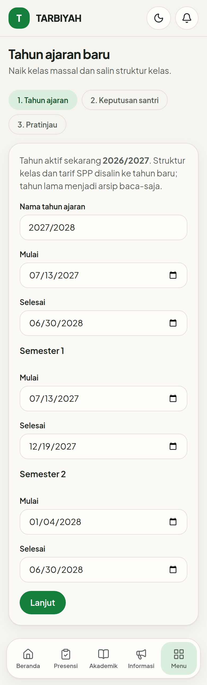

Lakukan setelah rapor semester genap dikunci dan tagihan tahun lama beres.

1. Buat **backup manual** (Sistem › Backup & restore).
2. **Data Sekolah › Tahun ajaran baru**:
   1. Periksa nama dan tanggal tahun ajaran serta semester baru (diusulkan otomatis).
   2. Periksa keputusan tiap santri. Usulan: **naik** ke tingkat berikutnya; kelas tertinggi
      diusulkan **lulus**. Bila suatu unit belum punya kelas tingkat berikutnya, semua santrinya
      ikut diusulkan lulus; periksa dengan teliti. Ubah bila perlu: tinggal kelas, lompat kelas,
      pindah sekolah, atau lulus.
   3. Lihat pratinjau, lalu **Jalankan** dan konfirmasi.
3. Hasilnya: tahun baru aktif, struktur kelas, wali kelas, dan tarif SPP disalin; santri lulus
   dan pindah tidak lagi aktif dan tidak ditagih; **tahun lama menjadi arsip baca-saja**.
4. Sesudahnya: periksa wali kelas, atur ulang **pengajaran dan jadwal** (tidak ikut disalin), dan
   tambahkan santri baru.
5. Keliru? Pulihkan backup dari langkah 1.

## Backup dan restore

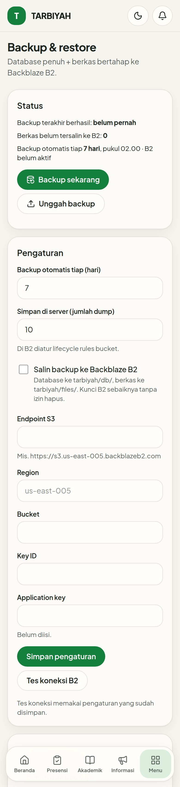

**Sistem › Backup & restore** (hanya admin).

- **Otomatis**: database penuh setiap N hari pukul 02.00, disimpan di server dan disalin ke
  Backblaze B2. Disarankan **setiap 1 hari**. Lampiran dan logo disalin ke B2 sekali per berkas.
- **Backup sekarang**: sebelum perubahan besar (tahun ajaran baru, impor besar, rilis versi baru).
- **Unduh** satu backup tiap akhir semester dan simpan di Google Drive lembaga.
- Bila backup gagal, admin menerima notifikasi; periksa halaman ini.

**Restore** mengganti SEMUA data dengan isi backup: pilih backup › **Pulihkan** › ketik nama
lembaga untuk konfirmasi. Aplikasi otomatis membuat backup kondisi sekarang, masuk mode
pemeliharaan, memulihkan, lalu kembali normal. Pengguna mungkin perlu masuk ulang.

Backup yang hanya ada di B2 (server baru): **Backup di B2 › Ambil ke server › Pulihkan**. Berkas
`.dump` dari Google Drive: **Unggah backup › Pulihkan**.

## Log aktivitas

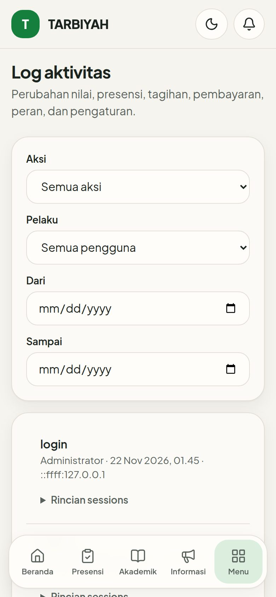

**Sistem › Log aktivitas** mencatat siapa mengubah nilai, presensi lampau, tagihan, pembayaran,
peran, pengaturan, backup/restore, dan persetujuan data, dengan filter aksi, pengguna, dan
tanggal. Gunakan bila ada pertanyaan "siapa yang mengubah ini?".
